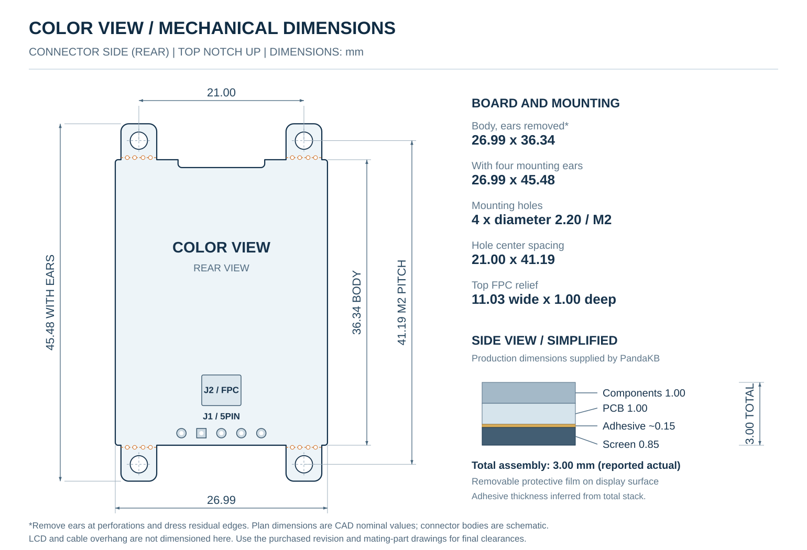

# Color View

### 面向ZMK分体键盘的8色Memory LCD显示模块

[English](README.md) · **简体中文** · [日本語](README.ja.md)

让DIY键盘用彩色显示层号、电池状态、连接信息，以及你自己的界面。

Color View是面向DIY键盘的显示模块，尺寸1.33英寸、分辨率128 × 128、支持8色。模块通过电源、地、SCK、MOSI和CS五路连接接入键盘。

**购买信息：**目前尚未上架，正式发售后会在这里添加购买链接。

**仓库进度：**当前为文档起步版。已有定制Helix键盘搭配nice!nano v2的Color View参考实现；本仓库尚未发布可复用的公共驱动包及可直接编译的键盘示例。

## 封装库下载

- [嘉立创EDA库 ZIP](downloads/ColorView-EasyEDA-v0.2.0.zip?raw=true)
- [KiCad库 ZIP](downloads/ColorView-KiCad-v0.2.0.zip?raw=true)
- [器件选择与导入说明](hardware/ColorView-Library/README.zh-CN.md)

包含5个器件的符号、封装及STEP模型：五针接口、带耳/去耳安装方案，以及独立的HC-FPC-05-10-5RLTAG FPC连接器。

## 从这里开始

| 你的需求 | 对应文档 |
| --- | --- |
| 确认接口、电源和接线 | [硬件与接线](docs/hardware.md) |
| 查看尺寸、厚度和可掰除的M2安装耳 | [尺寸与安装](docs/mechanical.md) |
| 确认主控或键盘的适配情况 | [兼容性](docs/compatibility.md) |
| 了解如何接入ZMK | [ZMK接入说明](docs/zmk.md) |
| 参考显示内容和界面布局 | [界面设计参考](docs/display-layouts.md) |
| 查找固件示例及发布状态 | [示例目录](examples/README.md) |

详细技术文档目前以英文维护；三个README版本使用相同的硬件参数和支持状态。

## 可以设计哪些界面

- 显示当前层、电池和USB／蓝牙输出状态的简洁状态页。
- 用不同颜色区分层号，搭配小图标。
- 显示键位布局，并高亮本侧实际按下的按键。
- 显示个人Logo，或由键盘事件触发的小动画。

以上是固件可实现的界面方向，显示模块本身不内置这些功能。副侧能显示哪些信息，取决于键盘固件的状态同步实现。

## 参数概览

| 项目 | 说明 |
| --- | --- |
| 显示 | 1.33英寸，128 × 128像素 |
| 颜色 | 黑、白、红、绿、蓝、青、品红、黄 |
| 接口 | SPI写入：SCK、MOSI、高有效CS；无MISO |
| 参考接线 | VCC：稳压3.3 V或5 V供电；信号：3.3 V逻辑电平 |
| 主要面向 | 使用ZMK的分体键盘DIY用户 |
| 参考主控 | 定制Helix工程中的nice!nano v2 |

模块制造方确认VCC可接稳压3.3 V或5 V；信号脚使用3.3 V逻辑，现有ZMK参考方案采用3.3 V供电。目前尚未公布模块实测功耗。接入前请阅读[电源与验证说明](docs/hardware.md#power-and-validation)。

## 尺寸、安装与接口

- **两种接线方式：**J1为1 × 5、2.54 mm间距的排针接口；J2为5Pin、0.50 mm间距的FPC接口，下接触，适配接触端厚度0.30 mm的排线。二选一使用。
- **PCB外形：**保留四个安装耳时为26.99 × 45.48 mm；掰除安装耳并修整残留边缘后，主体名义尺寸为26.99 × 36.34 mm。
- **安装孔：**四个可掰除的安装耳，每个带一个适用于M2螺丝的2.20 mm孔；孔中心距21.00 × 41.19 mm。
- **厚度：**PCB 1.00 mm、元件高度1.00 mm、屏幕厚度0.85 mm，PCB与屏幕之间还有胶层。实际装配总厚度为3.00 mm；胶层厚度按上述数据推算约为0.15 mm。
- **保护膜：**屏幕表面带有可撕除保护膜，使用前可揭掉。

孔位坐标见[尺寸与安装](docs/mechanical.md)，接口方向见[引脚示意图](assets/wiring/color-view-connectors.svg)。平面尺寸为CAD名义尺寸；结构设计时请结合购买版本及配套连接件预留空间。

## 接入前确认

1. 确认模块版本和连接器引脚编号。
2. 确认键盘有三根可用的信号GPIO。
3. 按接线表连接；J1和J2的引脚编号顺序不同。
4. 使用适配Color View的驱动及对应键盘配置。
5. 检查颜色、方向、休眠唤醒及左右两侧，再投入日常使用。

Color View需要匹配的彩色显示驱动，普通单色驱动不能直接替代。即使显示静态画面，模块供电期间也应保持受支持驱动的后台显示维护运行。

## 关注项目

上架页面、产品实拍、接线示意图和经过验证的固件示例会陆续补充。可以收藏[本仓库](https://github.com/PandaKBLab/color-view)，方便后续查阅。

反馈接入问题时，请提供键盘版本、主控、模块版本、ZMK版本、GPIO接线，以及相关错误或编译日志。

由**PandaKB / PandaKBLab**维护。接入ZMK还需要匹配的显示驱动，可参考[ZMK官方显示配置说明](https://zmk.dev/docs/config/displays)。
