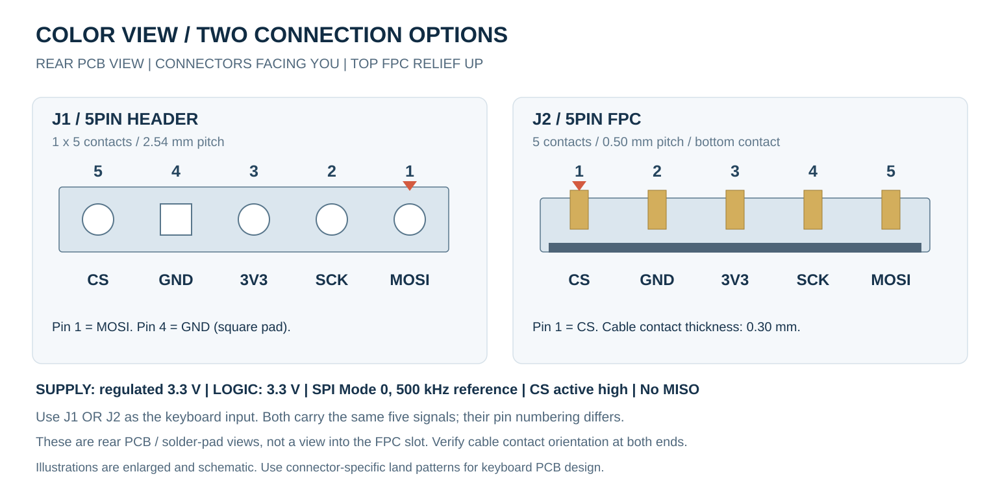

# Dimensions and installation

[Project overview](../README.md) · [Hardware and wiring](hardware.md) · [ZMK](zmk.md)

All dimensions below are in **millimetres**. The plan dimensions come from the current Color View PCB and are rounded to 0.01 mm. PCB, component, screen, and assembled thickness values were supplied by the manufacturer; adhesive thickness is inferred from their total. These are different sources, not a tolerance specification for every finished module.

## Dimensions

| Feature | Dimension |
| --- | --- |
| PCB body, excluding ears | 26.99 × 36.34 |
| PCB envelope, including four ears | 26.99 × 45.48 |
| M2 mounting-hole diameter | 2.20, four holes |
| Mounting-hole center spacing | 21.00 horizontal × 41.19 vertical |
| Top FPC relief | 11.03 opening width × 1.00 depth |
| PCB thickness | 1.00 |
| Component height | 1.00 |
| Adhesive between PCB and screen | Approximately 0.15, inferred from the stack total |
| Screen thickness | 0.85 |
| Actual assembled thickness | **3.00** |

The adhesive layer between the PCB and screen accounts for the remaining thickness: **components 1.00 + PCB 1.00 + adhesive approximately 0.15 + screen 0.85 = assembled 3.00 mm**. The adhesive position is confirmed by the manufacturer; its approximately 0.15 mm thickness is calculated from the supplied values, not independently measured. Optional headers, mating connectors, cables, screw heads, and standoffs require additional clearance. LCD and cable overhang are not dimensioned in this PCB drawing.

## Coordinate reference for keyboard PCB design

Use the **connector-side rear view**, with the top FPC relief pointing upward. The origin (0, 0) is the virtual lower-left corner of the main PCB body's bounding box, excluding the ears; +X is right and +Y is up. Viewing the module from the screen side mirrors the X direction.

### Mounting-hole centers

| Position in rear view | X | Y |
| --- | --- | --- |
| Lower left | 3.00 | -2.43 |
| Lower right | 24.00 | -2.43 |
| Upper left | 3.00 | 38.77 |
| Upper right | 24.00 | 38.77 |

The negative lower-hole Y values are intentional: these holes are in ears outside the main body. Coordinates are rounded independently, so use the stated 41.19 mm center spacing rather than subtracting rounded Y values.

### External interface pad centers

| Signal | J1 pin | J1 X, Y | J2 pin | J2 X, Y |
| --- | --- | --- | --- | --- |
| MOSI | 1 | 18.58, 1.53 | 5 | 14.50, 8.40 |
| SCK | 2 | 16.04, 1.53 | 4 | 14.00, 8.40 |
| VCC (3.3 V or 5 V) | 3 | 13.50, 1.53 | 3 | 13.50, 8.40 |
| GND | 4 | 10.96, 1.53 | 2 | 13.00, 8.40 |
| CS | 5 | 8.42, 1.53 | 1 | 12.50, 8.40 |

J1 coordinates refer to through-hole pad centers. J2 coordinates refer to the five electrical solder-pad centers on the module, not the insertion face of a cable. They locate the existing module interface; use the chosen mating connector's own land pattern when designing a keyboard PCB.

- **J1:** 1 × 5, 2.54 mm pitch; pin 1 is MOSI. The square pad is GND, pin 4.
- **J2:** 5 contacts, 0.50 mm pitch, bottom contacts; cable contact-section thickness 0.30 mm; pin 1 is CS.
- Use J1 or J2 as the input. The [wiring table](hardware.md#connector-pin-numbers) lists their different pin-number orders.

## Removable M2 mounting ears

All four mounting ears are optional and can be broken off at their perforated necks. Each ear has one 2.20 mm hole for an M2 screw and four breakaway holes at the neck.

Keep the ears when mounting with M2 screws. If removing them, support the main PCB close to the neck and avoid transferring bending force into the screen or its flexible cable. Dress any residual stub and remove debris before installing the module. The body dimensions above assume the remaining edges have been dressed; a freshly broken edge may protrude.

Keep the top FPC relief smooth and free of burrs. Allow space for the cable and its bend; do not clamp it against an edge.

## Protective film

The screen surface has a removable protective film. It can be peeled off before use.
